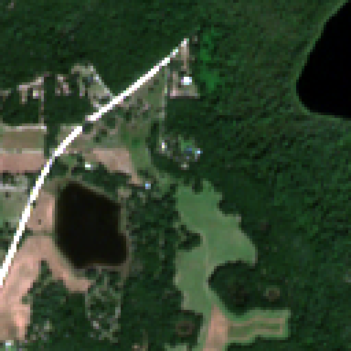

---
hide:
  - navigation
  - toc
---

  

    
OpenSR Model Zoo

    <h1>Sentinel-2 single-image super-resolution</h1>
    
Python implementations of pretrained models and interpolation baselines, with versioned inference recipes, verified checkpoints, and per-prediction metadata.

    

      <a href="installation/">Installation</a>
      <a href="quickstart/">CPU inference example</a>
    

    

      <strong>15</strong> versioned recipes
      <strong>2× / 4×</strong> output grids
      <strong>RGB + NIR</strong> inputs
    

  

  <figure class="hero-visual sr-figure">
    

      

        
        
        
Sentinel-2 · 10 mSR · 2.5 m

      

      <label class="comparison-control">Move the comparison split
        <input type="range" min="0" max="100" value="50" aria-label="Comparison split for the OSBS lake scene">
      </label>
    

    <figcaption>SEN2SR Lite · SEN2NEON OSBS · seed 0 <a href="examples/#display-settings-and-provenance">Display settings and reference</a></figcaption>
  </figure>

## Installation and examples

### Environment

Set up Python 3.12 and the locked environment with `uv`. The supported platform is Linux x86_64.

[Installation →](installation.md)

### CPU inference

Run the bilinear interpolation recipe on a synthetic tensor without downloading checkpoints.

[Quickstart →](quickstart.md)

### SEN2NEON comparisons

Observed Sentinel-2 inputs, saved SEN2SR Lite predictions, and aligned NEON references for three scenes.

[Image gallery →](examples.md)

## Model recipes and input requirements

The catalog includes SEN2SR, LDSR-S2, SRGAN, SR4RS, Evoland, Swin2-MoSE,
Satlas, and interpolation baselines. Each recipe records its input bands,
physical units, output grid, inference settings, and verified weight sources.
Predictions retain masks and provenance for later inspection.

Most recipes use Sentinel-2 RGB-NIR reflectance. Satlas uses rendered RGB TCI.
Use [the catalog](models/catalog.md) to check a model's input and device support,
and [the data guide](usage.md) to prepare your own crop.

## Evaluation protocol and results

The [held-out benchmark](closed-benchmark.md) provides a common RGB-NIR 128→512
task for understanding model strengths and trade-offs. Its leaderboard preview
will share category and overall indices after scoring calibration is complete.

The [SEN2NEON workflow](benchmarks-sen2neon.md) prepares observed Sentinel-2
inputs and aligned NEON references. The evaluation tools save per-sample scores,
timings, seeds, and runtime metadata. The
[benchmark results](performance.md) and [OpenSR-Test pilot](validation.md)
document the evaluated cohorts, metrics, and limitations.

## Development status

OpenSR maintains this research package. Version `0.1.0.dev0` is a development
release, with eleven experimental learned recipes. See
[release status](release-status.md) for validation coverage and publication plans.
This is an OpenSR project, not an official ESA product.
